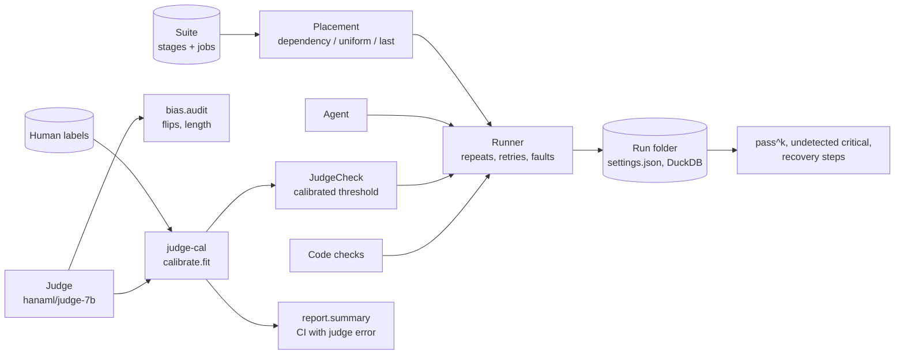

# hana-evals

Evaluation for long agent jobs, with judges you can trust a known amount. `eval-harness` runs multi-stage jobs many
times, scores every stage and decides where a limited review budget should go; `judge-cal` measures a model-as-judge
against human labels, corrects its biases and calibrates its scores. Together, a judged stage is checked by a judge
whose error rate is known, and that error is carried into the reported interval.

| Component | What it does |
| --- | --- |
| [`eval-harness`](packages/eval-harness) | Jobs as graphs of stages; dependency-aware check placement; fault injection and recovery; pass^k; run folders with their settings. |
| [`judge-cal`](packages/judge-cal) | Position and length bias audits, order swapping, isotonic or Platt calibration on human labels, and confidence intervals that include the judge's error. |
| [`hana-evals`](packages/hana-evals) | The glue: `calibrated_check()` turns a calibrated judge into an eval-harness check, plus an offline reference-based judge backend. |

## Architecture



- A stage marked `check: judge` (for example the supplier email in `suites/back-office`) is checked by the
  `JudgeCheck` that `hana_evals.calibrated_check` builds; code stages are checked against the stage's tool.
- The same calibrator scores a batch of outputs afterwards, and `judge_cal.report.summary` gives the acceptance rate
  with an interval that resamples the human labels as well as the items.

## Quickstart

```bash
git clone https://github.com/hanaml-lab/hana-evals && cd hana-evals
uv sync
uv run python examples/end_to_end.py
```

The example calibrates a judge on `examples/data/email-labels.jsonl`, runs the six-job reconciliation suite eight
times per job under two placement strategies, and prints pass^k, undetected critical errors and the email acceptance
interval. It runs offline with a seeded simulated agent and a reference-based judge; point `Judge` at a vLLM server
running `hanaml/judge-7b` and the agent config at your model to measure real systems.

```python
from eval_harness import Runner, Suite
from hana_evals import calibrated_check
from judge_cal import Judge

judge = Judge(endpoint="http://localhost:8000/v1", model="hanaml/judge-7b",
              rubric="packages/judge-cal/rubrics/faithfulness.yaml")
check, cal = calibrated_check(judge, "labels/heldout-300.jsonl")
result = Runner(agent="packages/eval-harness/configs/agent.yaml", repeats=8,
                review_budget=0.2, judge_check=check).run(Suite.load("packages/eval-harness/suites/back-office"))
print(result.pass_k(8), result.undetected_critical_per_100)
```

## Development

```bash
make test     # each package's tests, then the integration test
make lint
```

## Related

- Research: [long-job evaluation suite](https://hanaml.com/research/long-job-evaluation-suite),
  [judge calibration](https://hanaml.com/research/judge-calibration).
- Papers: [Calibrating model judges against human labels](https://hanaml.com/research/papers/calibrating-llm-judges),
  [The cost of reliability in long agent runs](https://hanaml.com/research/papers/cost-of-reliability-long-runs).
- Model: [judge-7b](https://hanaml.com/models/judge-7b).
- [hana-agents](https://github.com/hanaml-lab/hana-agents) and [hana-knowledge](https://github.com/hanaml-lab/hana-knowledge)
  are evaluated with this harness.

## Licence

Apache-2.0. See `LICENSE`.
