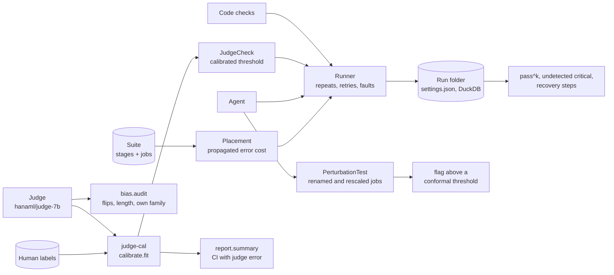

# hana-evals

[](https://github.com/hanaml-lab/hana-evals/actions/workflows/ci.yml)
[](LICENSE)

Evaluation for long agent jobs, with evaluators whose own error is measured. `eval-harness` runs multi-stage jobs
many times, scores every stage, places a limited review budget where an error would cost most downstream, and tests
whether a run that passes its checks passes them for the right reason. `judge-cal` measures a model judge against
human labels, audits its position, length and self-preference biases, and calibrates its scores. A judged stage is
then checked by a judge whose error rate is known, and that error is carried into the reported interval. This is the
system repo of the hanaML research project
[long-horizon evaluation with calibrated judges](https://hanaml.com/research/trustworthy-evals).

| Component | Language | What it does |
| --- | --- | --- |
| [`eval-harness`](packages/eval-harness) | Python | Jobs as graphs of stages; check placement by propagated error cost; fault injection and recovery; pass^k; verifier perturbation testing; run folders with their settings and DuckDB tables; an Inspect adapter for tau-bench and SWE-bench Verified. |
| [`judge-cal`](packages/judge-cal) | Python | Order swapping; position, length and self-preference audits; agreement statistics; isotonic or Platt calibration on human labels; bootstrap intervals that include the judge's error. |
| [`hana-evals`](packages/hana-evals) | Python | The glue: `calibrated_check()` turns a calibrated judge into an eval-harness check, plus an offline reference-based judge backend. |

## Install

```bash
git clone https://github.com/hanaml-lab/hana-evals && cd hana-evals
uv sync                      # Python 3.10+; installs the three packages as a uv workspace
```

`pip install ./packages/eval-harness[duckdb]` and `pip install ./packages/judge-cal` install a component on its own.
The `inspect` extra of eval-harness adds tau-bench and SWE-bench Verified through Inspect (those need a network and
Docker); `packages/eval-harness/docker/sandbox.Dockerfile` builds the per-run sandbox.

## Quickstart

```bash
uv run python examples/end_to_end.py        # calibrate a judge, compare check placements, report an interval
uv run python examples/perturbation_test.py # flag an agent that passes every check by replaying leaked answers
```

Both run offline in seconds, with a seeded simulated agent and a reference-based judge. `end_to_end.py` prints:

```text
judge calibration: ECE 0.194 -> 0.058, agreement with humans 0.84 (n=160)
      last: pass^1 0.63  pass^8 0.02  undetected critical per 100 runs 2.1
   uniform: pass^1 0.65  pass^8 0.03  undetected critical per 100 runs 4.2
dependency: pass^1 0.67  pass^8 0.04  undetected critical per 100 runs 0.0
human-accept rate 0.600 (95% CI 0.498-0.703; judge-as-truth CI 0.417-0.688; 48 items, 160 human labels)
judge vs human: accuracy 0.844
```

To measure a real system, point `Judge` at a vLLM server running `hanaml/judge-7b` and the agent config at your
model:

```python
from eval_harness import Runner, Suite
from hana_evals import calibrated_check
from judge_cal import Judge

judge = Judge(endpoint="http://localhost:8000/v1", model="hanaml/judge-7b",
              rubric="packages/judge-cal/rubrics/faithfulness.yaml")
check, cal = calibrated_check(judge, "labels/heldout-300.jsonl")
result = Runner(agent="packages/eval-harness/configs/agent.yaml", repeats=8,
                review_budget=0.2, judge_check=check).run(Suite.load("packages/eval-harness/suites/back-office"))
print(result.pass_k(8), result.undetected_critical_per_100)
```

## Architecture



- A stage marked `check: judge` (the supplier email in `suites/back-office`) is checked by the `JudgeCheck` that
  `hana_evals.calibrated_check` builds; a code stage is checked against its tool on the inputs it actually received.
- Because a check catches only the errors made at its own stage, `dependency` placement ranks stages by the loss
  their errors cause downstream. It corrupts each stage's reference output, replays the job's pure tools through every
  dependant and sums the undo cost of what ends up wrong, counting critical stages twice.
- `perturbation.PerturbationTest` re-runs an agent on instances of the job whose references the tools recompute:
  `surface` renames record references and shuffles rows, `rescale` multiplies every amount by one factor. A passing run
  whose pass rate collapses on them is flagged above a split-conformal threshold fitted on honest runs.
- The same calibrator scores a batch of outputs afterwards, and `judge_cal.report.summary` gives the acceptance rate
  with an interval that resamples the human labels as well as the items.

## Results

### Reproduced by this repo

Offline, on the six-job back-office suite, with the commands in the Quickstart.

| What | Number | Command |
| --- | --- | --- |
| Undetected critical errors per 100 runs, 30% of stages checked, 240 runs: last stages / evenly spaced / by propagated cost | 2.1 / 4.2 / 0.0 | `examples/end_to_end.py` |
| Judge expected calibration error, before and after isotonic calibration (160 human labels) | 0.194 to 0.058 | `examples/end_to_end.py` |
| Replaying agent, every stage checked: pass^8 | 1.00 | `examples/perturbation_test.py` |
| Replaying agent flagged by the perturbation test (alpha 0.1) | 6 of 6 jobs | `examples/perturbation_test.py` |
| Fresh honest runs that pass their checks, flagged | 8 of 76 (10.5%) | `examples/perturbation_test.py` |

The simulated agent and the reference-based judge make these numbers exactly repeatable; they show the mechanisms,
not the performance of a real model.

### Reported in the papers

The project's two papers report these numbers; each row quotes its paper. Both papers are seeded simulation studies
calibrated to published magnitudes, as their limitations sections say. PARC's criterion judge, two-stage audit and
estimator, and VPT's harness isolation and property tests, are in the paper repos.

| Metric | Baseline | Result | Setting | Paper |
| --- | --- | --- | --- | --- |
| 95% interval half-width at 8 annotator-hours, TheAgentCompany / DevAI / BackOffice | ±11.5 / ±12.8 / ±13.9 pts | ±4.9 / ±5.8 / ±4.8 pts | Mean partial credit; grading whole runs by hand vs. PARC with a calibrated Qwen3-32B criterion judge | [PARC](https://hanaml.com/research/papers/calibrating-llm-judges) |
| Human time saved against grading whole runs | 1.0× | 6.0× | Hours whole-run grading needs to match PARC's half-width at 8 h, divided by 8, mean of three suites; active inference 4.1× | PARC |
| Coverage of nominal 95% intervals | 81–88% | 94.9–95.4% | Three suites at 8 h; the same audit with criteria treated as independent vs. PARC's run-level variance | PARC |
| Regressions shipped by a release gate | 24–33% | 2.1% | 24 BackOffice agent versions, δ = 2 points; judge-only gates vs. interval gates | PARC |
| Criterion verdict accuracy against people | 82.2% | 90.4% | Qwen3-32B, calibrated, pooled over suites; rubric in context vs. criterion judge with retrieval (ECE 0.031 vs. 0.025) | PARC |
| Recall at 1% FPR, all hacks | 73.0% | 78.1% | 6,240 verifier-passing rollouts, 1,412 audited hacks; CoT+action monitor vs. VPT, at 118 vs. 31 GPU-minutes per 1,000 rollouts | [VPT](https://hanaml.com/research/papers/detecting-reward-hacking) |
| Recall at 1% FPR, rewritten reasoning-dependent hacks | 1.9% | 74.7% | 345 reasoning-dependent hacks after four trace-rewrite passes; CoT+action monitor vs. VPT | VPT |
| Hack rate after 600 GRPO steps | 42.3% | 5.9% | Qwen3-8B on RL-Coding, 3 seeds; CoT-monitor penalty vs. VPT penalty | VPT |

### Reported by the components

`eval-harness` reports these in its README; no paper covers them.

| Metric | Baseline | Result | Note |
| --- | --- | --- | --- |
| Undetected critical errors per 100 runs | 7.8 | 2.9 | Fixed checkpoints vs. dependency-aware placement, same review budget |
| pass^8 (all 8 repeats succeed), tau-bench airline | 21% | 30% | Same model; adaptive checks and replanning |
| Reviewer minutes per completed job | 11.4 | 6.2 | Uniform review of every write vs. risk-ranked review |
| Recovery time after injected fault (median steps) | 9 | 3 | Faults detected later cost more steps to undo |

## Papers

The project's papers, in order. Both measure an evaluator's own error on held-out, human-audited data and carry it
into what is reported: an interval for a calibrated judge, a false-positive bound for a hack detector.

| Date | Paper | What this repo implements | PDF | Paper repo |
| --- | --- | --- | --- | --- |
| 2026-01-20 | [Judging Long Agent Runs with Valid Error Bars: Prediction-Powered Audits of Rubric Criteria](https://hanaml.com/research/papers/calibrating-llm-judges) | `judge-cal`: bias probes, order swapping, isotonic and Platt calibration, intervals that include the judge's error; `hana-evals`: the calibrated judge as a stage check. The criterion judge, the two-stage audit and the prediction-powered estimator are in the paper repo. | [PDF](https://hanaml.com/papers/calibrating-llm-judges.pdf) | [calibrating-llm-judges](https://github.com/hanaml-lab/calibrating-llm-judges) |
| 2026-10-07 | [Verifier Perturbation Testing: Trace-Independent Detection of Reward Hacking in RL-Trained Coding Agents](https://hanaml.com/research/papers/detecting-reward-hacking) | `eval-harness.perturbation`: the invariance gap, robust standardisation and the split-conformal threshold, with two perturbation families for staged jobs. The paper's sandboxed harness isolation and specification-derived property tests are in the paper repo. | [PDF](https://hanaml.com/papers/detecting-reward-hacking.pdf) | [detecting-reward-hacking](https://github.com/hanaml-lab/detecting-reward-hacking) |

Related: [Where to Check: Budget-Optimal Placement of Verifiers and Rollbacks for Long-Horizon Agents](https://hanaml.com/research/papers/cost-of-reliability-long-runs)
models check placement and retries for long runs; [hana-agents](https://github.com/hanaml-lab/hana-agents) and
[hana-knowledge](https://github.com/hanaml-lab/hana-knowledge) are evaluated with this harness.

## Models

- [judge-7b](https://hanaml.com/models/judge-7b): a 7B pairwise judge trained to ignore answer order and length,
  with scores calibrated against human raters by `judge-cal`.

## Development

```bash
make test       # each package's tests, then the integration test
make lint       # ruff
make example    # both offline examples
```

CI runs lint, the tests and both examples on Python 3.10 and 3.12, validates the notebook and `CITATION.cff`, and
builds the sandbox image.

## Contributing

See [CONTRIBUTING.md](CONTRIBUTING.md). Report security issues as described in the
[hanaML security policy](https://github.com/hanaml-lab/.github/blob/main/SECURITY.md).

## Citation

If you use hana-evals, please cite it (`CITATION.cff` has the same record):

```bibtex
@software{hanaml_hana_evals_2026,
  author  = {{hanaML}},
  title   = {hana-evals: evaluation for long agent jobs with calibrated judges},
  year    = {2026},
  version = {0.6.0},
  url     = {https://github.com/hanaml-lab/hana-evals}
}
```

If you use judge calibration or the perturbation test, please also cite the paper:

```bibtex
@techreport{agarwal2026calibrating,
  author      = {Agarwal, Manav},
  title       = {Judging Long Agent Runs with Valid Error Bars: Prediction-Powered Audits of Rubric Criteria},
  institution = {hanaML},
  type        = {Technical report},
  year        = {2026},
  url         = {https://hanaml.com/research/papers/calibrating-llm-judges}
}

@techreport{agarwal2026vpt,
  author      = {Agarwal, Manav},
  title       = {Verifier Perturbation Testing: Trace-Independent Detection of Reward Hacking in RL-Trained Coding Agents},
  institution = {hanaML},
  type        = {Technical report},
  year        = {2026},
  url         = {https://hanaml.com/research/papers/detecting-reward-hacking}
}
```

## Licence

Apache-2.0. See [LICENSE](LICENSE).
