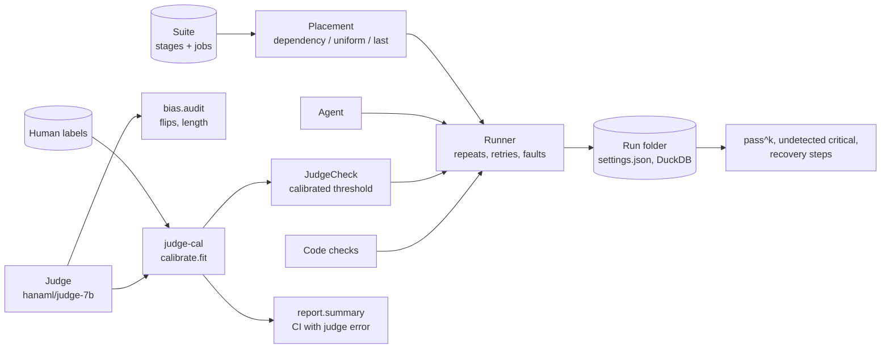

# hana-evals

Evaluation for long agent jobs, with judges you can trust a known amount. `eval-harness` runs multi-stage jobs many
times, scores every stage and decides where a limited review budget should go; `judge-cal` measures a model-as-judge
against human labels, corrects its biases and calibrates its scores. Together, a judged stage is checked by a judge
whose error rate is known, and that error is carried into the reported interval.

| Component | What it does |
| --- | --- |
| [`eval-harness`](packages/eval-harness) | Jobs as graphs of stages; dependency-aware check placement; fault injection and recovery; pass^k; run folders with their settings. |
| [`judge-cal`](packages/judge-cal) | Position and length bias audits, order swapping, isotonic or Platt calibration on human labels, and confidence intervals that include the judge's error. |
| [`hana-evals`](packages/hana-evals) | The glue: `calibrated_check()` turns a calibrated judge into an eval-harness check, plus an offline reference-based judge backend. |

## Architecture

- A stage marked `check: judge` (for example the supplier email in `suites/back-office`) is checked by the
  `JudgeCheck` that `hana_evals.calibrated_check` builds; code stages are checked against the stage's tool.
- The same calibrator scores a batch of outputs afterwards, and `judge_cal.report.summary` gives the acceptance rate
  with an interval that resamples the human labels as well as the items.
